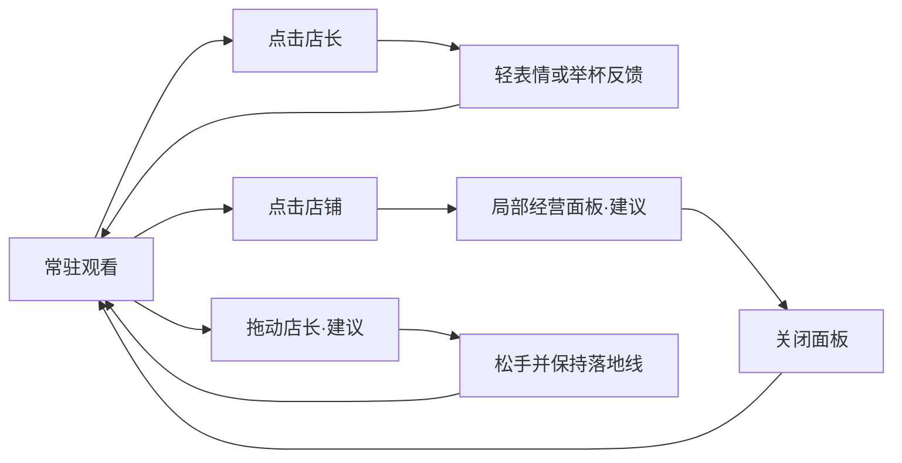

# 任务栏酒馆交互讨论说明 V1

日期：2026-10-17。状态：讨论稿，不是已验收的 UX 规格。

> 第二轮用户反馈已取代下文的部分待定建议：店长自由游走且可与顾客闲聊；店铺、桌椅和角色均可拖动并自由摆放；常驻占比 5–10%。V1 的 20–25% 和拖动只改变 X 不再是当前方向。V2 见 `../../art/desktop_tavern_v2/`。

## 目标

桌面上常驻一个沿任务栏展开的小酒馆。常态用于观看和陪伴，操作通过角色、店铺和局部小面板完成，保留大部分桌面空间。

当前资料来自用户布局与店长原稿、双 MVP 简报及现有 `desktop-window` 规格；尚无正式玩家旅程、Art Bible 或系统 GDD，因此新增细节均是提案。

## 来源与提案对照

| 对象 | 原稿 / 当前承诺 | 本轮建议 | 尚待确认 |
| --- | --- | --- | --- |
| 店长 | 沿 X 轴活动；第二张图定义形象 | 单击举杯/表情；拖动只改变横向位置，松手继续待机 | 是否能进入吧台、是否承担服务、游走范围 |
| 店铺 | 贴任务栏的小酒摊 | 点招牌或吧台打开小经营面板 | 整组能否横向移动、固定在哪侧 |
| 顾客 | 座椅待机；现有自动来客服务循环 | 先等位后入座，低频气泡及收益飘字 | 座位数、满员等待、消费与久坐关系 |
| 经营面板 | 材料研发与酒单属于 MVP2 规划 | 菜单/研发/摘要为三个入口，关面板回到观看 | 未实现，需后续独立设计与数值规则 |
| 工具入口 | 固定常驻、最小化、保存退出已经承诺 | 悬停出现「⋯」，减少常态工具条；音量入口作为提案 | 「⋯」是否常显；音频尚未实现 |
| 桌面空白 | 视觉透明已有实现 | 建议允许点击下方应用 | 鼠标穿透尚未实现，必须先技术验证 |

## 空间建议

- 以任务栏可用上沿为落地基线，店长脚底、店铺轮子和座椅脚在同一条线上。
- 拖动店长的反馈与拖动整个店铺必须有不同入口，避免操作混淆。
- 效果图放大用于看造型；实际默认高度建议占屏幕的 20–25%，不在本轮锁定像素值。
- 原稿只表达底部任务栏。自动隐藏任务栏、DPI、多屏和其他任务栏位置需在后续运行时设计中定义，不能由图稿直接承诺。
- 小面板在店铺附近展开，靠近屏幕边缘时向内调整；不把完整经营页面常驻铺满桌面。

## 最小交互链

## 反馈与可用性建议

- 单击与拖动应使用位移阈值区分，拖拽结束不误触发点击。
- 收益飘字短暂且低频，主要数值在店铺附近查看，不持续抢注意力。
- 窗口始终常驻但不抢其他应用输入焦点；主动最小化后不自动弹回。
- 显示文字至少采用清楚的描边/底片，避免浅色桌面上消失；不只靠颜色区分可操作状态。
- 后续若增加点击穿透，操作目标命中区域与透明空白区域必须分开验证。

## 待讨论

首先确认画风与店长造型，其次确认店长的角色分工和店铺移动方式；最后再锁定默认比例与经营面板细节。所有选择完成后再创建实现任务。
