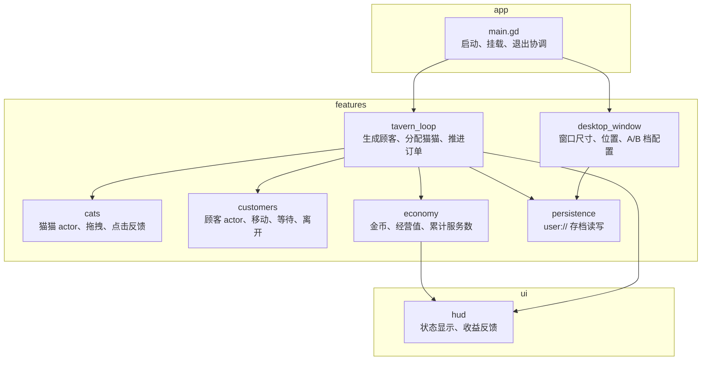
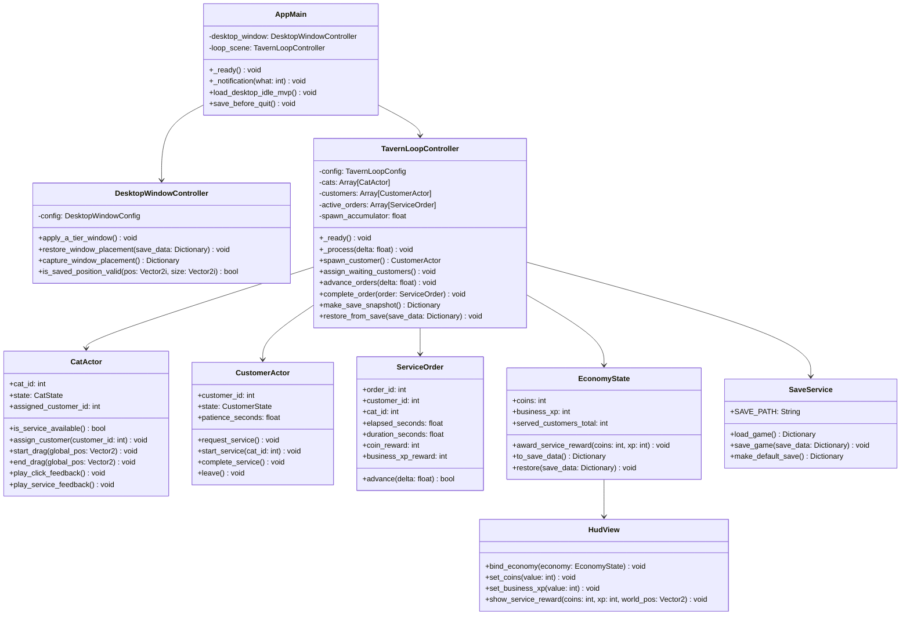
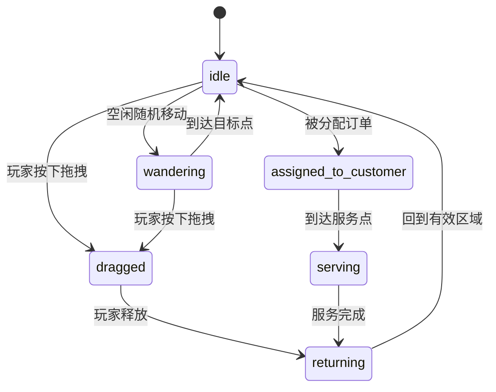
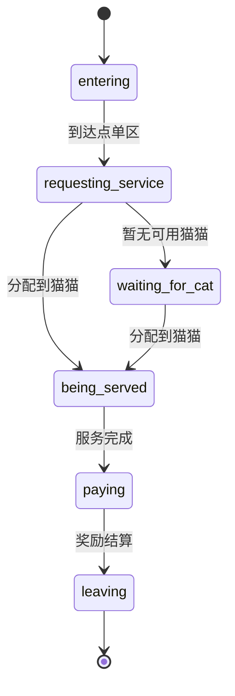

# 桌面挂机 MVP 技术设计

> 窗口设计更新（2026-10-17）：原生透明与默认置顶已由 `enable-transparent-desktop-window` 提升为当前要求，当前行为见 `openspec/specs/desktop-window/spec.md`。下文 A/B 档保留为原始设计背景；点击穿透仍属后续范围。

## 目标

构建一个最小 Windows 桌面小酒馆，用来验证桌面陪伴感、猫猫交互、顾客服务可读性，以及可持久化的基础收益。

这个 MVP 应该显得鲜活，但技术上保持克制。它不解决完整经营游戏，只验证第一层基础循环。

## 已验证运行环境

- Godot 可执行文件：`C:\Users\shame\Downloads\Godot_v4.6.3-stable_win64.exe\Godot_v4.6.3-stable_win64.exe`
- `--headless --version` 输出：`4.6.3.stable.official.7d41c59c4`
- `--headless --path D:\MaomaoClub\MaoMaoClub --quit --verbose` 可打开当前项目并正常退出。
- Godot verbose 输出中的手柄 mapping `misc2` 警告不影响本 MVP 的鼠标交互和项目启动。

## 窗口档位

### A 档：MVP 必须达成

A 档是第一版可玩验证目标。

- 只面向 Windows。
- 小尺寸无边框窗口，尺寸适合桌面陪伴小酒馆。
- 初始位置贴近桌面边缘；能简单取得屏幕信息时，优先放在任务栏上方附近。
- 窗口位置和尺寸在重启后保留。
- 允许使用占位背景；不要求真正 OS 级透明。
- 窗口在普通桌面使用中保持可交互和稳定。

### B 档：后续增强

B 档是桌面宠物体验增强，不阻塞第一版基础循环。

- 真透明背景。
- 可靠置顶行为。
- 适配常见 Windows 任务栏位置。
- 多显示器位置保存与恢复。
- 可选的点击穿透或输入区域裁剪。

点击穿透刻意拆到后续，是因为它可能需要普通 GDScript 之外的 Windows 专用 API。如果 Godot 4.6.3 无法直接覆盖，应在后续 spike 中评估 C#、GDExtension 或原生辅助程序。

## 分层架构



依赖规则：

- `app` 可以创建和挂载 feature，但不能持有具体玩法状态。
- `tavern_loop` 可以协调猫猫、顾客、经济和存档，但不能直接改 HUD 节点文本。
- `cats` 和 `customers` 不直接写经济，也不直接保存文件。
- `economy` 不知道具体场景节点，只负责状态和信号。
- `persistence` 不知道场景结构，只读写字典快照。
- `ui` 是投影层，只订阅信号和展示反馈。

## UML 类图



## 核心循环

运行时循环如下：

```mermaid
sequenceDiagram
    participant Loop as TavernLoopController
    participant Customer as CustomerActor
    participant Cat as CatActor
    participant Order as ServiceOrder
    participant Economy as EconomyState
    participant Save as SaveService
    participant Hud as HudView

    Loop->>Customer: spawn_customer()
    Customer->>Loop: request_service
    Loop->>Cat: is_service_available()
    Loop->>Order: new(customer_id, cat_id, duration, reward)
    Loop->>Cat: assign_customer(customer_id)
    Loop->>Customer: start_service(cat_id)
    loop 每帧或每个 tick
      Loop->>Order: advance(delta)
    end
    Order-->>Loop: completed
    Loop->>Economy: award_service_reward(coins, xp)
    Economy-->>Hud: coins_changed / business_xp_changed
    Loop->>Customer: complete_service(); leave()
    Loop->>Save: save_game(snapshot)
```

玩家交互不改变这条主链路，只改变猫猫可用性：被拖拽时不可接单，释放并回到有效区域后重新可用。

## 状态机

### 猫猫状态



### 顾客状态



## 服务定义

一次服务是一笔占位销售。它代表猫猫准备或递出一杯饮品，但不需要玩家选择配方。

服务订单由 `ServiceOrder` 表示，不做成 Node。它是轻量数据对象，避免为每笔订单增加场景树开销。

订单字段：

```text
order_id: int
customer_id: int
cat_id: int
elapsed_seconds: float
duration_seconds: float
coin_reward: int
business_xp_reward: int
```

订单推进规则：

- `TavernLoopController._process(delta)` 调用 `advance_orders(delta)`。
- 每个订单累加 `elapsed_seconds`。
- 达到 `duration_seconds` 后调用 `complete_order(order)`。
- 完成时只结算一次奖励，并释放猫猫和顾客。

## 状态归属

- `TavernLoopController` 拥有顾客生成、活跃顾客列表、服务分配和队列上限。
- `CatActor` 拥有猫猫表现、点击反馈、拖拽状态和服务动画状态。
- `CustomerActor` 拥有顾客表现和本地移动状态。
- `EconomyState` 拥有金币、经营值和累计服务顾客数。
- `SaveService` 拥有 `user://` 的序列化和反序列化。
- `HudView` 只拥有显示，并通过信号更新。
- `DesktopWindowController` 拥有窗口位置和未来桌面窗口选项。

表现节点不得直接修改经济数据。顾客和猫猫 actor 发出事件或调用窄接口；经济变化统一发生在 `EconomyState`。

## 数据模型

使用 typed GDScript 和小型 Resource 或 RefCounted 数据结构。

初始可配置值：

```text
cat_count = 3
max_active_customers = 4
customer_spawn_interval_seconds = 6.0 到 10.0
service_duration_seconds = 4.0 到 7.0
coin_reward_min = 5
coin_reward_max = 12
business_xp_reward = 1
window_size = Vector2i(960, 360)
```

主要货币和经营值使用整数。不要用 float 保存货币。

## 代码结构管理

推荐目录：

```text
app/
  main.tscn
  main.gd
features/
  desktop_window/
    desktop_window_controller.gd
    desktop_window_config.gd
  tavern_loop/
    tavern_loop.tscn
    tavern_loop_controller.gd
    tavern_loop_config.gd
    service_order.gd
  cats/
    cat_actor.tscn
    cat_actor.gd
    cat_config.gd
    cat_state.gd
  customers/
    customer_actor.tscn
    customer_actor.gd
    customer_config.gd
    customer_state.gd
  economy/
    economy_state.gd
    reward_table.gd
  persistence/
    save_service.gd
ui/
  hud/
    hud.tscn
    hud_view.gd
```

文件管理规则：

- 每个 feature 目录可以包含自己的 `.tscn`、`.gd`、`.tres`、占位 art 和 audio。
- 不创建 `scripts/`、`scenes/`、`assets/sprites/` 这类长期类型目录。
- 只服务一个 feature 的占位资源留在该 feature 目录下。
- 变成多功能共享后，再迁移到 `assets/shared/` 或 `common/`。
- 状态枚举可以放在 `cat_state.gd`、`customer_state.gd`，避免魔法字符串散落。
- 配置优先放在 Resource 类或 config 脚本，不把数值硬编码在多个 actor 中。
- `app/main.gd` 保持薄入口，不超过启动、挂载、退出保存协调职责。

## Tick 与性能模型

酒馆循环使用一个中心 accumulator 推进生成和服务，不为每个实体堆 Timer 节点。

- 顾客生成由 `TavernLoopController` 控制。
- 服务完成通过每个 `ServiceOrder` 的累计耗时追踪。
- 视觉移动可以使用 tween 或少量 actor 的轻量 `_process`。
- HUD 只在信号驱动的数值变化时更新。
- 不在 `_process` 中调用 `get_nodes_in_group()`；由控制器缓存自己拥有的 actor 数组。

MVP 只有少量 actor，普通 Node 场景足够。暂不需要 Server API、对象池或 BigNumber 型挂机经济。

## 持久化

保存到 `user://maomao_club_save.cfg` 或 `user://maomao_club_save.json`。第一版建议用 `ConfigFile`，因为字段少、可读、适合 typed Godot 值。

保存字段：

```text
save_version: int
coins: int
business_xp: int
served_customers_total: int
window_position: Vector2i
window_size: Vector2i
last_saved_unix_time: int
```

读取时要允许字段缺失并使用默认值。关闭并重启游戏后恢复进度，但本 MVP 不发放离线收益。

保存触发点：

- 服务完成并发放奖励后。
- 窗口位置或尺寸变化后。
- 收到 `NOTIFICATION_WM_CLOSE_REQUEST` 或退出通知时。

## 信号

预期信号：

```text
EconomyState.coins_changed(new_value: int)
EconomyState.business_xp_changed(new_value: int)
EconomyState.customer_served(total_served: int)
TavernLoopController.customer_spawned(customer_id: int)
TavernLoopController.service_started(customer_id: int, cat_id: int)
TavernLoopController.service_completed(customer_id: int, cat_id: int, coins: int, business_xp: int)
CatActor.clicked(cat_id: int)
CatActor.drag_started(cat_id: int)
CatActor.drag_ended(cat_id: int)
DesktopWindowController.window_placement_changed(position: Vector2i, size: Vector2i)
```

单个场景内部优先使用直接父子信号。除非后续系统确实需要，否则不引入宽泛全局信号总线。

## 落代码顺序

1. 建立 `app/main` 和 `features/tavern_loop/tavern_loop` 空场景，让项目能从薄入口进入 MVP。
2. 建立 `DesktopWindowController`，先完成 A 档窗口尺寸、无边框和位置恢复。
3. 建立 `SaveService` 和 `EconomyState`，先用按钮或临时代码验证保存/读取。
4. 建立三只 `CatActor` 占位节点，完成点击和拖拽。
5. 建立 `CustomerActor` 占位节点，完成进入和离开路径。
6. 建立 `ServiceOrder` 和 `TavernLoopController` 的分配逻辑，让顾客能被猫猫服务。
7. 接入 HUD，显示金币、经营值、累计服务数和收益飘字。
8. 连续运行 10 分钟，修正队列堆积、状态卡死和保存时机。
9. 实现完成后将稳定行为合并到正式 spec 并归档 change。

## 验证计划

当前 MVP 阶段允许手动验证。

- 使用 Windows 的 Godot 4.6.3 启动。
- 确认 A 档窗口出现在桌面边缘附近。
- 确认恰好三只猫猫可见并可交互。
- 连续运行 10 分钟，确认顾客持续进店、接受服务、付款和离开。
- 在服务过程中拖拽猫猫，确认循环能干净恢复。
- 确认金币和经营值只在服务完成时增加。
- 退出并重启，确认保存的数值和窗口位置恢复。
- 确认 MVP 通过不依赖调酒策略或离线收益。
