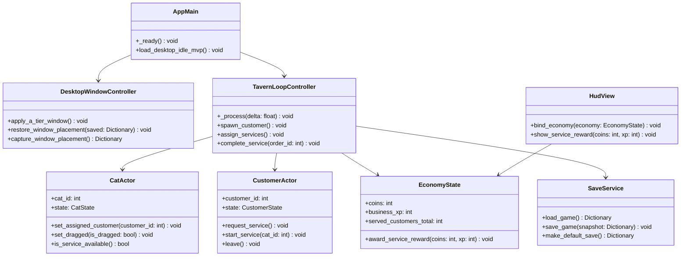
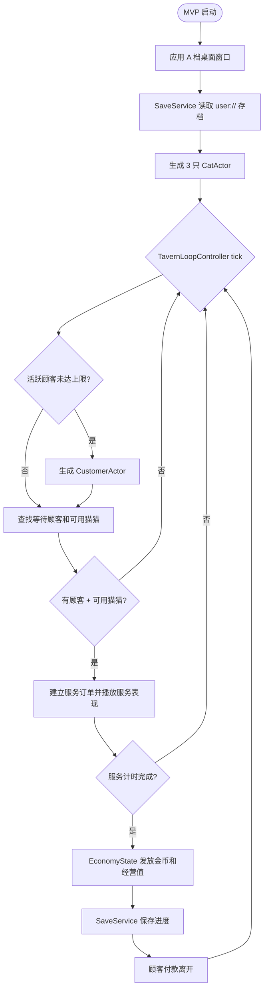

# validate-desktop-idle-mvp

> 窗口范围更新（2026-10-17）：用户明确要求真正的无边框半透明桌面版。`enable-transparent-desktop-window` 单独实现并验收原生透明、置顶和窗口操作；本文件的 A/B 档是原始 MVP 拆分记录，当前窗口行为以 `openspec/specs/desktop-window/spec.md` 为准。旧 MVP 的其他未完成验收继续保留。

## 为什么要做

MaoMaoClub 需要验证第一个可玩承诺：一个只面向 Windows 的桌面小酒馆，能停留在玩家日常桌面旁边，不需要持续操作也能显得鲜活。

这个 MVP 只验证桌面陪伴与挂机层。它要证明：三只猫猫、简单顾客流、清楚的服务过程、可持久化的基础收益，是否足以让桌面小酒馆值得被持续观看。调酒策略保留到后续 MVP，避免把“桌面存在感是否成立”和“经营深度是否成立”混在一起判断。

## 已验证环境

- Godot 可执行文件：`C:\Users\shame\Downloads\Godot_v4.6.3-stable_win64.exe\Godot_v4.6.3-stable_win64.exe`
- 验证命令：`--headless --version`
- 验证版本：`4.6.3.stable.official.7d41c59c4`
- 验证日期：2026-07-01
- 项目启动检查：`--headless --path D:\MaomaoClub\MaoMaoClub --quit --verbose` 退出码为 0。输出中出现的手柄 mapping `misc2` 警告不阻塞项目启动。

## 改动内容

- 定义 Windows-only 的桌面挂机 MVP。
- 优先实现 A 档可玩桌面窗口：稳定、无边框、贴近桌面边缘、使用占位美术，并具备完整服务循环。
- 将 B 档桌面宠物体验作为后续增强：真透明背景、置顶行为、任务栏/多屏适配，以及可能的点击穿透支持。
- 第一版启动时展示三只占位猫猫。
- 猫猫可以被点击、拖拽、释放；被拖拽时暂时不可服务顾客。
- 生成占位顾客，顾客会进店、请求服务、等待可用猫猫、付款并离开。
- 服务完成后发放可持久化的金币和经营值。
- 游戏退出和重启后保留玩家可见进度与窗口位置。
- 使用占位美术和简单可读动画，不等待正式美术。

## 代码实现框架

本 MVP 按功能拆分，不按脚本类型拆分。`app` 负责启动，`features/*` 负责玩法切片，`ui/*` 负责界面投影。



## 运行时服务流程



## 代码结构管理

```text
app/
  main.tscn
  main.gd
features/
  desktop_window/
    desktop_window_controller.gd
    desktop_window_config.gd
  tavern_loop/
    tavern_loop.tscn
    tavern_loop_controller.gd
    tavern_loop_config.gd
    service_order.gd
  cats/
    cat_actor.tscn
    cat_actor.gd
    cat_config.gd
    cat_state.gd
  customers/
    customer_actor.tscn
    customer_actor.gd
    customer_config.gd
    customer_state.gd
  economy/
    economy_state.gd
    reward_table.gd
  persistence/
    save_service.gd
ui/
  hud/
    hud.tscn
    hud_view.gd
```

管理规则：

- `app/main.gd` 只做启动和挂载，不写顾客、猫猫、经济细节。
- `features/tavern_loop/` 是本 MVP 的编排中心，只负责分配和状态推进，不持久化文件、不直接写 UI。
- `features/cats/` 和 `features/customers/` 只拥有各自 actor 的表现、输入和本地状态。
- `features/economy/` 是金币、经营值和累计服务数的唯一写入位置。
- `features/persistence/` 只读写 `user://`，不直接操作场景节点。
- `ui/hud/` 只订阅信号并显示状态，不反向修改经济数据。
- 占位资源跟随所属功能目录；变成多功能共享后再迁到 `assets/shared/`。
- 新增生产 GDScript 必须 typed，函数必须写显式返回类型。

## 不在本次范围

- 调酒研发和酒水配方策略。
- 今日菜单影响。
- 超出占位差异的顾客类型经济调优。
- 抽猫、繁育、长期猫猫成长、高级家具、驻演、联网涂鸦墙、长期熟客剧情。
- 关游戏期间的离线收益。
- 原生 Windows 点击穿透行为，除非后续技术 spike 确认采用 Windows API、C# 或 GDExtension 路线。

## 影响范围

- 规格：`desktop-idle-experience`
- 设计：`openspec/changes/validate-desktop-idle-mvp/design.md`
- 未来代码：`app/`、`features/desktop_window/`、`features/tavern_loop/`、`features/cats/`、`features/customers/`、`features/economy/`、`features/persistence/`、`ui/hud/`
- 验证：Godot 4.6.3 Windows 启动检查、10 分钟手动挂机、保存/重启验证、typed GDScript 检查
