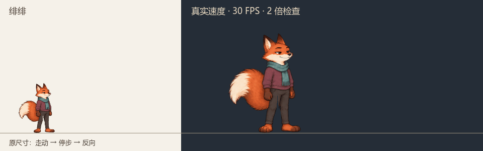
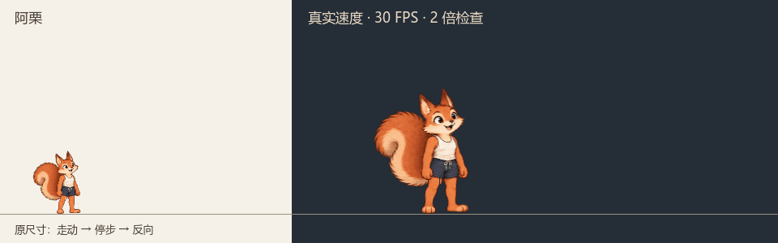

# 实际速度行走预览

30 FPS 引擎输出，每段 4.4 秒。左侧为常驻原尺寸，右侧为两倍检查；向右 2 秒、停步 0.4 秒、向左 2 秒。

## bartender

## customer_capybara

## customer_dog

## customer_fox

## customer_rabbit

## customer_raccoon

## customer_squirrel

## manager

## server

## server_carry

